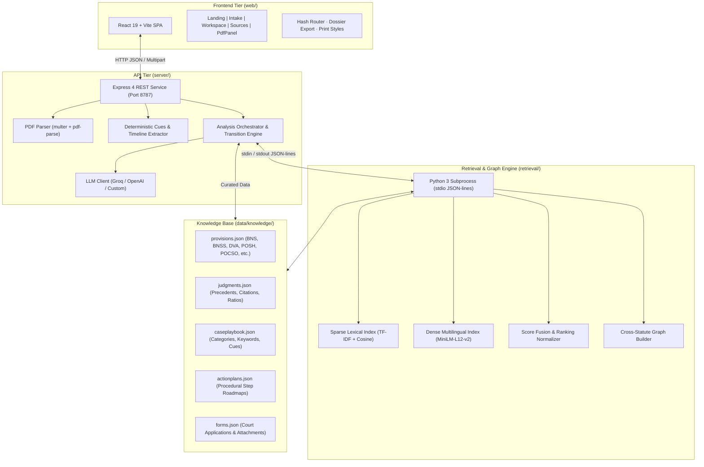
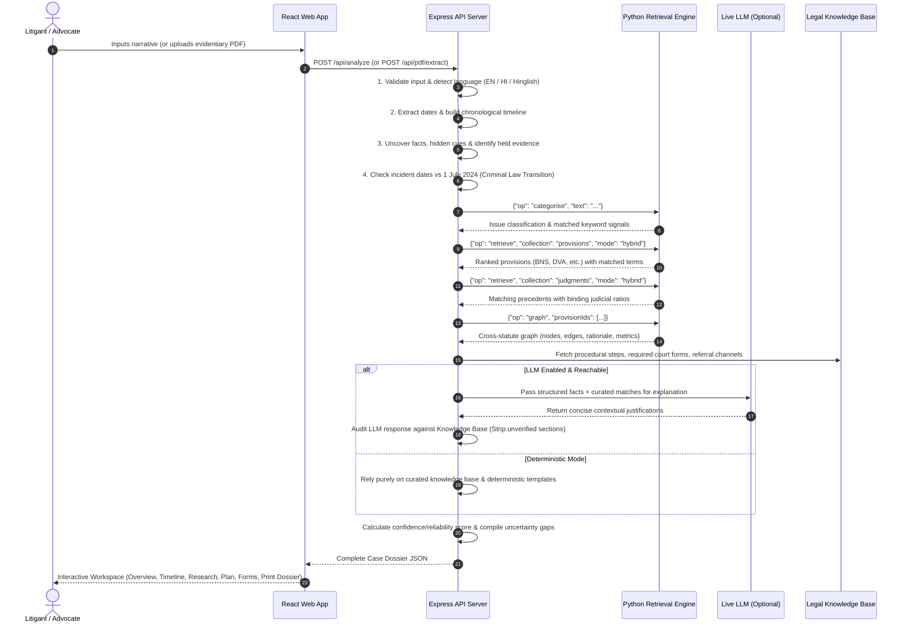

# JollyLLM (न्यायपथ)
### AI-Driven Legal Advocate & Pro Se Strategy Engine

> **"Know Your Rights in Ten Minutes"**  
> *Domain: Legal Tech & Access to Justice | Problem Statement: PS5*

---

## 📑 Table of Contents
1. [Overview & Problem Statement](#-overview--problem-statement)
2. [Proposed Solution & Core Philosophy](#-proposed-solution--core-philosophy)
3. [Key Capabilities & Features](#-key-capabilities--features)
4. [System Architecture](#-system-architecture)
5. [End-to-End Workflow Pipeline](#-end-to-end-workflow-pipeline)
6. [Multilingual & Transliteration Engine](#-multilingual--transliteration-engine)
7. [Hybrid Retrieval & Precedent Search](#-hybrid-retrieval--precedent-search)
8. [Cross-Statute Interlinking Graph](#-cross-statute-interlinking-graph)
9. [Criminal Law Transition Engine (IPC vs BNS)](#-criminal-law-transition-engine-ipc-vs-bns)
10. [Grounding & Zero-Hallucination Guardrails](#-grounding--zero-hallucination-guardrails)
11. [Repository Structure](#-repository-structure)
12. [Curated Legal Knowledge Base](#-curated-legal-knowledge-base)
13. [API Reference](#-api-reference)
14. [Getting Started & Installation](#-getting-started--installation)
15. [Configuration & Environment Variables](#-configuration--environment-variables)
16. [Verification & Testing](#-verification--testing)
17. [Ethical Considerations, SDGs & Disclaimers](#-ethical-considerations-sdgs--disclaimers)

---

## 🎯 Overview & Problem Statement

Across India, millions of citizens encounter legal disputes, domestic harassment, property conflict, or rights violations every day. The vast majority cannot afford legal counsel or access timely assistance. When forced to represent themselves (*pro se* litigants), they face overwhelming barriers:
- **Procedural Incomprehensibility:** Inability to identify which exact sections, forms, or judicial forums apply.
- **Statutory Silos:** Typical disputes span civil remedies, penal actions, and special protective acts simultaneously (e.g., a domestic dispute involves the Domestic Violence Act, Bharatiya Nyaya Sanhita / IPC, and criminal procedure), yet citizens only pursue fragmented remedies.
- **Flawed Generic AI Chatbots:** Standard LLM chatbots deliver generic legal definitions, hallucinate non-existent sections and deadlines, invent case law, and cannot safely correlate personal facts with judicial precedent.
- **The July 1, 2024 Transition Confusion:** The replacement of the Indian Penal Code (IPC), Code of Criminal Procedure (CrPC), and Indian Evidence Act (IEA) with the Bharatiya Nyaya Sanhita (BNS), Bharatiya Nagarik Suraksha Sanhita (BNSS), and Bharatiya Sakshya Adhiniyam (BSA) created widespread confusion on which law applies based on incident timelines.

**JollyLLM** resolves these obstacles by converting unstructured case narratives into an actionable, cross-statutory defense blueprint within **ten minutes**—strictly anchored to verified law and historical precedents without hallucination.

---

## 💡 Proposed Solution & Core Philosophy

JollyLLM operates as an intelligent legal companion and *pro se* defense architect. It accepts narratives in **English, Hindi (Devanagari), or Hinglish (Romanised Hindi)** and uploaded evidentiary PDFs.

```
 Case Narrative / PDF Upload
             │
             ▼
 ┌───────────────────────────────┐
 │ Deterministic Extract & Audit │  ◄── Date extraction, cue mining, 
 └──────────────┬────────────────┘      timeline construction, statute check
                ▼
 ┌───────────────────────────────┐
 │   Hybrid Retrieval Engine     │  ◄── Sparse TF-IDF + Dense Multilingual
 └──────────────┬────────────────┘      Sentence Embeddings (384-dim)
                ▼
 ┌───────────────────────────────┐
 │ Cross-Statute Knowledge Graph │  ◄── Dynamic interlinking across penal,
 └──────────────┬────────────────┘      civil, and special enactments
                ▼
 ┌───────────────────────────────┐
 │ Guardrailed AI Synthesis      │  ◄── Zero-hallucination synthesis:
 └──────────────┬────────────────┘      LLM explains; facts anchor to corpus
                ▼
 Actionable Dossier & Filing Roadmap
```

### Core Architectural Axioms
1. **Zero-Hallucination Grounding:** No statute, section number, court form, or precedent citation is generated from an LLM's imagination. Every statutory authority displayed must exist within the curated, verified legal knowledge base.
2. **Dual-Mode Execution:** The system functions 100% deterministically offline without any LLM API key. When an LLM (Groq / OpenAI) is configured, it enriches the explanations (*"Why this provision applies to your account"*), while preserving strict factual anchors.
3. **Conservative Self-Auditing:** If facts are missing, deadlines are ambiguous, or no matching precedent exists, the system warns the user openly and directs them to the nearest District Legal Services Authority (DLSA) or emergency lines.

---

## ⚡ Key Capabilities & Features

| Capability | Technical Realization | Pro Se Litigant Benefit |
| :--- | :--- | :--- |
| **Document Parsing & Cue Extraction** | `pdf-parse` and deterministic date/fact extractors mining chronologies and hidden facts. | Uncovers loose facts and organizes fragmented narratives into an admissible timeline. |
| **Cross-Statute Interlinking** | Graph construction linking criminal penal provisions, civil remedies, and special acts. | Formulates multi-pronged claims so users do not forfeit civil remedies when filing criminal complaints. |
| **Precedent Matching** | Dense vector search (`paraphrase-multilingual-MiniLM-L12-v2`) blended with sparse TF-IDF, citing binding ratios. | Provides authoritative Supreme Court & High Court citations with direct Indian Kanoon verification links. |
| **Criminal Transition Engine** | Automatic temporal reasoning evaluating incidents relative to **1 July 2024** (IPC vs BNS applicability). | Prevents filing under repealed or invalid penal provisions. |
| **Pro Se Defense Blueprint** | Step-by-step roadmap, required filing forms, evidence checklist (held vs to gather), and deadlines. | Litigants know exactly which counter to approach, which forms to fill, and what evidence to bring. |
| **Emergency & Legal Aid Routing** | Automatic risk detection triggering urgent referrals (112, 1930 Cyber helpline, DLSA/NALSA). | Immediate safety guidance for domestic abuse, sexual violence, or immediate danger. |

---

## 🏛 System Architecture

JollyLLM consists of three cohesive tiers communicating via high-speed, local protocols:



---

## 🔄 End-to-End Workflow Pipeline

When a user submits a case through the web interface or API, the following sequence executes:



---

## 🌐 Multilingual & Transliteration Engine

Access to justice demands native language support:
1. **Pure Hindi (Devanagari):** Analyzed with an n-gram window (unigram and adjacent word runs) normalized via Unicode NFKC.
2. **Hinglish (Phonetic Romanised Hindi):** Litigants frequently express urgent crises using Roman characters for Hindi speech (e.g., *"pati ne mara aur ghar se nikal diya"*). JollyLLM features an embedded semantic mapping table converting phonetic terms:
   - `pati` / `poti` $\rightarrow$ पति (husband)
   - `saas` $\rightarrow$ सास (mother-in-law)
   - `peet` / `mara` $\rightarrow$ मारपीट (battery / physical violence)
   - `dhamki` $\rightarrow$ धमकी (criminal intimidation)
   - `dhan` $\rightarrow$ दहेज (dowry)
   - `thagi` / `dhokha` $\rightarrow$ धोखाधड़ी (fraud / cheating)
3. **Language Detection:** Automatically identifies English, Hindi, and mixed-script narratives to tailor output recommendations and summary presentations.

---

## 🔍 Hybrid Retrieval & Precedent Search

Legal vocabulary presents a dual challenge: exact statutory language requires keyword precision, while everyday vernacular requires conceptual semantic matching. JollyLLM implements **Hybrid Search**:

### 1. Sparse Vector Space (TF-IDF)
- Tokenizes legal provisions and case judgments.
- Employs Inverse Document Frequency (IDF) weighting and Cosine Similarity.
- Highlights exact statutory terms matched in the user's narrative.

### 2. Dense Semantic Vector Space
- Powered by `paraphrase-multilingual-MiniLM-L12-v2` (384 dimensions).
- Pre-encodes knowledge base documents with cached vector representations (`retrieval/.cache/embeddings.npz`) for instant warm restarts.
- Maps colloquial descriptions to dense conceptual vectors.

### 3. Min-Max Rank Fusion
Because sparse TF-IDF and dense cosine scores exist on disparate scales, scores are normalized via Min-Max scaling and blended:

$$\text{Score}_{\text{hybrid}} = \frac{w_{\text{sparse}} \cdot \widetilde{S}_{\text{sparse}} + w_{\text{dense}} \cdot \widetilde{S}_{\text{dense}}}{w_{\text{sparse}} + w_{\text{dense}}}$$

---

## 🕸 Cross-Statute Interlinking Graph

Self-represented citizens frequently do not know that one wrongful act triggers remedies across distinct legal codes. JollyLLM generates an **Interlinking Subgraph** that maps relations between provisions:

```
        ┌────────────────────────────────┐
        │       Domestic Violence        │
        └───────────────┬────────────────┘
                        │
       ┌────────────────┴────────────────┐
       ▼                                 ▼
┌──────────────┐                 ┌──────────────┐
│ Protection   │  Same-Filing    │ Maintenance  │
│ Order (Civil)│◄───────────────►│ & Residence  │
│  DVA s. 18   │                 │  DVA s. 12   │
└──────┬───────┘                 └──────┬───────┘
       │                                │
       │ Shared Vocabulary              │ Cross-Statute
       ▼                                ▼
┌──────────────┐                 ┌──────────────┐
│  Cruelty /   │                 │ Wrongful     │
│ Dowry Abuse  │                 │ Restraint    │
│  BNS s. 85   │                 │  BNS s. 126  │
└──────────────┘                 └──────────────┘
```

### Edge Relationship Types:
- **`same-filing-step`:** Provisions that can be filed jointly in a single application before the Magistrate (e.g., Protection + Residence + Maintenance under DVA s. 12).
- **`same-issue-cross-statute`:** Overlapping protections spanning criminal punishment and civil restitution (e.g., BNS criminal battery vs. DVA civil protection).
- **`shared-legal-vocabulary`:** Statutorily distinct provisions that trigger on identical conduct elements.
- **`curated`:** Direct statutory relationships explicitly codified by legal scholars.

---

## ⚖ Criminal Law Transition Engine (IPC vs BNS)

On **1 July 2024**, India enacted three new criminal enactments:
- **Bharatiya Nyaya Sanhita (BNS), 2023** (replaced the Indian Penal Code, 1860)
- **Bharatiya Nagarik Suraksha Sanhita (BNSS), 2023** (replaced the Code of Criminal Procedure, 1973)
- **Bharatiya Sakshya Adhiniyam (BSA), 2023** (replaced the Indian Evidence Act, 1872)

Under Article 20(1) of the Constitution of India, substantive criminal law cannot apply retrospectively. JollyLLM includes a temporal reasoning rule:
1. **Incident dated strictly BEFORE 1 July 2024:** The system flags that substantive offenses occurred prior to the transition date, alerting the litigant that IPC/CrPC governs the substantive offenses, while displaying current sections with cross-reference guidance.
2. **Incident dated ON or AFTER 1 July 2024:** Confirms that the Bharatiya Nyaya Sanhita (BNS) and BNSS apply directly.
3. **Undated / Ambiguous Narratives:** Warns the user of the critical importance of fixing dates to determine statutory applicability.

---

## 🛡 Grounding & Zero-Hallucination Guardrails

| Guardrail Layer | Implementation Mechanism | Protection Conferred |
| :--- | :--- | :--- |
| **Corpus Anchor** | Statutes, forms, and precedents are strictly loaded from verified JSON records. | No hallucinatory sections (e.g., "Section 999") can enter the response. |
| **Strict LLM Isolation** | The LLM is only prompted to explain *why* an already retrieved provision applies to the narrative. It is never permitted to generate statute citations. | Eliminates prompt injection exploits and fictional jurisprudence. |
| **Output Auditing** | Post-generation regex audit compares model output against the knowledge base; unrecognized references are stripped. | Guarantees 100% citation veracity. |
| **Statutory vs. Advisory Deadlines** | Deadlines are tagged as `from-source` (statutory limitation periods) or `advisory` (practical filing advice). | Prevents misleading litigants about legal limitation periods. |
| **Ephemeral Privacy** | In-memory processing; case narratives and uploaded files are never persisted to disk or external databases. Logs redact all secrets and personal data. | Complete confidentiality for victims of abuse. |

---

## 📁 Repository Structure

```
JollyLLM-legal-tech/
├── data/
│   └── knowledge/                      # Curated, authoritative legal corpus
│       ├── actionplans.json            # Step-by-step procedural roadmaps & deadlines
│       ├── caseplaybook.json           # Issue categories, keywords, forums, emergency data
│       ├── forms.json                  # Court applications, templates, required attachments
│       ├── judgments.json              # Supreme Court / High Court precedents & ratios
│       ├── provisions.json             # Central enactments (BNS, BNSS, DVA, POSH, POCSO, etc.)
│       └── samplecases.json            # Seeded demonstration cases (Hinglish, Hindi, English)
├── retrieval/
│   ├── .cache/                         # Pre-computed dense embeddings cache
│   └── engine.py                       # Python 3 retrieval engine (TF-IDF + MiniLM vector search)
├── server/
│   ├── .env.example                    # Environment variable template
│   ├── package.json                    # Backend dependencies (Express, Multer, pdf-parse)
│   └── src/
│       ├── analysis.js                 # Case analysis pipeline & transition engine
│       ├── extract.js                  # Deterministic date, fact, and timeline extractors
│       ├── index.js                    # Express API server & routes
│       ├── knowledge.js                # In-memory knowledge base loader
│       ├── llm.js                      # LLM integration client & schema enforcement
│       ├── pdf.js                      # PDF text extraction & size limits
│       └── retrievalClient.js          # Child process IPC wrapper for engine.py
├── web/
│   ├── index.html                      # HTML5 entry point with responsive viewport
│   ├── package.json                    # React 19 + Vite dependencies
│   ├── vite.config.js                  # Vite configuration
│   └── src/
│       ├── App.jsx                     # Root component, router, top bar & dossier actions
│       ├── api.js                      # Fetch client for the backend API
│       ├── main.jsx                    # React DOM bootstrapper
│       ├── style.css                   # Comprehensive design system (responsive, dark/light, print)
│       ├── ui.jsx                      # Reusable UI primitives (icons, badges, notices, tags)
│       └── views/
│           ├── Intake.jsx              # Case intake questionnaire & validation
│           ├── Landing.jsx             # Informational landing view
│           ├── PdfPanel.jsx            # Evidentiary PDF upload and text parser
│           ├── Sources.jsx             # Statutory and judgment library explorer
│           └── Workspace.jsx           # Pro se dossier (Overview, Timeline, Research, Plan, AI)
├── scripts/
│   ├── run.cmd                         # Windows one-click startup launcher
│   ├── test_extract.mjs                # Extraction test suite (Node test runner)
│   ├── test_retrieval.py               # Stdio protocol smoke test for retrieval engine
│   ├── add_binding_ratios.py           # Corpus curation helper for judgments
│   ├── add_narrative_cues.py           # Corpus curation helper for cue lexicon
│   ├── extract_statutes.py             # Utility for statute parsing
│   └── statute_probe.py               # Inspection script for provisions
└── _abstract.txt                       # Project abstract and requirements specification
```

---

## 📚 Curated Legal Knowledge Base

JollyLLM is bundled with comprehensive coverage of Indian central legislation:

### Covered Acts & Enactments
- **BNS, 2023:** Bharatiya Nyaya Sanhita (Offenses against women, property, body, computer-assisted offenses, criminal intimidation).
- **BNSS, 2023:** Bharatiya Nagarik Suraksha Sanhita (FIR registration, arrest procedures, medical examinations, private complaints).
- **DVA, 2005:** Protection of Women from Domestic Violence Act (Protection orders, residence orders, monetary relief, custody).
- **POSH, 2013:** Sexual Harassment of Women at Workplace Act (Internal Complaints Committee, inquiry procedure, interim relief).
- **POCSO, 2012:** Protection of Children from Sexual Offences Act (Mandatory reporting, emergency care, protective provisions).
- **ITACT, 2000:** Information Technology Act (Identity theft, cyber fraud, privacy violations, obscene material).
- **CPA, 2019:** Consumer Protection Act (Deficiency in service, misleading claims, consumer commissions).
- **NI, 1881:** Negotiable Instruments Act (Cheque bounce notices and s. 138 proceedings).

### Landmark Precedents & Judgments
Includes foundational rulings with binding ratios and direct verification URLs to **Indian Kanoon**:
- *S. R. Batra v. Taruna Batra* & *Satish Chander Ahuja v. Sneha Ahuja* (Shared household and residence rights under DVA)
- *Lalita Kumari v. Govt. of U.P.* (Mandatory registration of FIR in cognizable offenses)
- *Arnesh Kumar v. State of Bihar* (Guidelines on arrest under dowry and marital cruelty allegations)
- *Shreya Singhal v. Union of India* (Intermediary liability and freedom of online expression)
- *Vishaka v. State of Rajasthan* (Prevention of workplace sexual harassment)

### Optional Imported Legal Edition

The corpus can be extended additively with the `datagoblin_legal` edition without changing the six curated files:

- **Snapshot:** `data/knowledge/legal_edition.json`. When it is absent the app runs on the curated corpus exactly as before.
- **Sync:** `node scripts/sync_legal_edition.mjs --from <snapshot-path-or-URL>` (or set `LEGAL_EDITION_URL`).
- **Merge rule:** a curated record always wins. Imported records fill blanks on overlap and add net-new provisions and judgments with `origin: "imported"`, a source URL, verification status, and quote-backed provenance.
- **Browse:** the **Statutes** page shows merged provisions, judgments, an imported-edition tab, tier/origin filters, and CSV downloads.

---

## 🔌 API Reference

### Health & Metadata
- **`GET /api/health`**
  - Returns backend health, Python engine status (sparse vs dense readiness), LLM configuration, and corpus record counts.
- **`GET /api/meta`**
  - Returns supported acts, categories, referral channels, disclaimers, and authoritative legal sources.
- **`GET /api/corpus`**
  - Returns merged, curated, imported, and raw-edition counts plus facet tallies for the corpus browser.
- **`GET /api/edition`**
  - Returns the raw synced `legal_edition.json` snapshot, or `404 edition_not_synced` when the optional edition is absent.
- **`GET /api/corpus/export.csv?scope=merged|edition`**
  - Downloads the merged corpus or the raw imported edition as CSV.
- **`GET /api/samples`**
  - Returns seeded demo cases (e.g., Hinglish domestic violence, Hindi dowry dispute, English cyber fraud).

### Case Analysis & Extraction
- **`POST /api/analyze`**
  - Main analysis pipeline. Accepts JSON:
    ```json
    {
      "title": "Domestic violence and threats",
      "narrative": "Detailed narrative of the dispute...",
      "category": "domestic-violence",
      "location": "Jaipur, Rajasthan",
      "startDate": "2026-04-12"
    }
    ```
### Stateful Case Management & Conversational Intake
- **`POST /api/cases`**
  - Creates a stateful case, auto-classifies the category, extracts initial turn facts, and generates the first adaptive follow-up question.
- **`GET /api/cases`**
  - Lists all saved cases for the authenticated user.
- **`GET /api/cases/:caseId`**
  - Returns complete case state: version, structured facts with provenance, chronological timeline, active procedural plan, documents, and latest opponent simulation.
- **`GET /api/cases/:caseId/conversation`**
  - Retrieves chronological conversation messages for the case.
- **`POST /api/cases/:caseId/messages`**
  - Submits user response; handles non-blocking skips (`"I don't know"`, `"skip"`), detects factual contradictions, updates the case dossier, and returns the next adaptive question.
- **`POST /api/cases/:caseId/documents`**
  - Uploads an evidentiary PDF or plain-text file; extracts text, dates, and facts, and attaches them with provenance to the case dossier. The file is stored against that case only.
- **`GET /api/cases/:caseId/documents`**
  - Lists evidence documents linked to the case.
- **`GET /api/cases/:caseId/documents/:docId`**
  - Returns one document's stored text. The case is part of the lookup, so a document cannot be read from another workspace.
- **`DELETE /api/cases/:caseId/documents/:docId`**
  - Withdraws a document from the case and deletes its stored text.
- **`POST /api/cases/:caseId/transcript`**
  - Imports a finished consultation transcript. Each turn keeps the sender it actually had, and only the client's own statements become facts.
- **`GET /api/cases/:caseId/authorities`**
  - Lists the statutes and decisions this case relied on, each with the quote it rests on and where it came from.
- **`POST /api/cases/:caseId/facts/:factId/corrections`**
  - Formally corrects an established fact, marks the old fact superseded, invalidates downstream stale plans, and increments the case version.
- **`GET /api/cases/:caseId/action-plan`**
  - Returns the active procedural action plan with prerequisite evidence and statutory deadlines.
- **`POST /api/cases/:caseId/action-plan/items/:itemId/toggle`**
  - Toggles completion status of a procedural action step.

### Adversarial Opponent Simulation & Research Agents
- **`POST /api/cases/:caseId/opponent-simulation`**
  - Triggers the Courtroom Opponent Simulation Agent; returns opposing counsel's theory of the case, evidence attacks under BSA Section 63, grounded cross-examination questions, adverse precedents, ranked opponent moves, and "what-if" scenario assessments.
- **`GET /api/cases/:caseId/opponent-simulation`**
  - Retrieves the latest adversarial opponent simulation report.
- **`POST /api/cases/:caseId/research`**
  - Runs bounded legal research for a specific case query over the bundled corpus, and over a live datagoblin dataset when one is configured. The authorities relied on are recorded against the case.
- **`GET /api/cases/:caseId/research`**
  - Retrieves research run history and findings for the case.
- **`POST /api/legal/dataset/search`**
  - Searches a live datagoblin legal dataset by wording, over the stored page text. The dataset key stays on the server and only the search text is sent. Returns a clear "not configured" answer when no live dataset is set up.
- **`GET /api/legal/dataset/status`**
  - Reports whether a live datagoblin dataset is configured, without exposing the key.
- **`POST /api/cases/:caseId/workflow`**
  - Executes the full typed, stateful Python LangGraph workflow directly via the stdio IPC channel.

### Legacy Single-Shot & Corpus Lookup (Maintained for Backward Compatibility)
- **`POST /api/analyze`**
  - One-shot case analysis pipeline.
- **`POST /api/validate`**
  - Validates intake parameters.
- **`POST /api/pdf/extract`**
  - Standalone PDF text and timeline extraction.
- **`GET /api/provisions`** & **`GET /api/provisions/:id`**
  - Query provisions by `q`, `category`, `act`, `tier`, `state`, or `origin`, with `limit`/`offset` pagination.
- **`GET /api/judgments`** & **`GET /api/judgments/:id`**
  - Query the precedent database with the same filters, and access Indian Kanoon search verification URLs.
- **`GET /api/graph?provisions=DVA-12,BNS-85`**
  - Returns the cross-statute relational subgraph for the requested provision identifiers.
- **`GET /api/forms?category=domestic-violence`**
  - Returns court applications and attachment requirements for a specific dispute domain.
- **`GET /api/search?q=cyber+fraud&mode=hybrid`**
  - Free-text search across provisions and judgments using hybrid ranking.

---

## 🚀 Getting Started & Installation

### Prerequisites
- **Node.js:** v18.0.0 or newer (Node 22+ recommended; natively supports `.env` loading)
- **Python:** v3.9 or newer (with standard library; `sentence-transformers` and `torch` optional for dense vector embeddings)
- **Operating System:** Windows, Linux, or macOS

### 1. Quick Launch (Windows)
A pre-configured startup script is provided in the repository:
```cmd
scripts\run.cmd
```
*This verifies `node` and `python`, installs `node_modules` if missing, starts the backend API on port 8787, and launches the Vite development server on port 5173.*

### 2. Manual Setup

#### Step 1: Install Dependencies
```bash
# Install Server dependencies
cd server
npm install

# Install Web Frontend dependencies
cd ../web
npm install
```

#### Step 2: (Optional) Python Dense Embedding Dependencies
The Python engine runs out of the box using pure standard library (sparse TF-IDF mode). To enable dense multilingual semantic search:
```bash
pip install sentence-transformers torch numpy
```

#### Step 3: Run the Services
**Terminal 1 (Backend API):**
```bash
cd server
node src/index.js
# API running at http://localhost:8787
```

**Terminal 2 (Frontend Web App):**
```bash
cd web
npm run dev
# Web application running at http://localhost:5173
```

---

## ⚙ Configuration & Environment Variables

Copy `server/.env.example` to `server/.env`:

```env
# Enable or disable LLM enrichment (true | false)
LLM_ENABLED=true

# Supported providers: groq | openai | generic
LLM_PROVIDER=groq

# Your provider API key (kept strictly server-side)
LLM_API_KEY=your-api-key-here

# Target Model ID
LLM_MODEL=llama-3.3-70b-versatile

# Provider Base URL
LLM_BASE_URL=https://api.groq.com/openai/v1

# Request Timeouts & Limits
LLM_TIMEOUT_MS=20000
LLM_MAX_ATTEMPTS=2
LLM_JSON_MODE=true
```

> **Security Note:** `server/.env` is git-ignored. Never commit an API key, never place secrets in `web/`, and never prefix secrets with `VITE_` (Vite inlines `VITE_*` variables directly into client-side browser bundles).

---

## 🧪 Verification & Testing

### 1. Automated Test Suite (Node.js)
Runs all unit, regression, database, conversational intake, and end-to-end integration test suites:
- `test_extract.mjs` (17 tests): ISO 8601 parsing, DD-MM-YYYY Indian date conventions, Hindi date expressions, bare year handling, language script detection.
- `test_db.mjs` (4 tests): User & case creation, conversation persistence, fact provenance, fact corrections with downstream plan invalidation, opponent simulation storage.
- `test_intake.mjs` (3 tests): Multilingual intake classification (English, Hindi, Hinglish), adaptive questioning, non-blocking skips (`"I don't know"`), contradiction detection.
- `test_case_api.mjs` (8 tests): Full REST API integration covering case creation, messages, legal analysis, Courtroom Opponent Simulation Agent, Dynamic Legal Research Agent, fact corrections, corpus/count/filter/CSV endpoints, and LangGraph workflow invocation.

```bash
cd server
npm test
```
*Actual output: `tests 56 · pass 56 · fail 0`*

### 2. Retrieval Engine Smoke Tests (Python)
Validates stdio protocol communication, sparse TF-IDF scoring, Hindi and English keyword categorisation, and judgment retrieval:
```bash
python scripts/test_retrieval.py
```
*Actual output: `FAILURES: 0`*

### 3. LangGraph Agentic Workflow Test (Python)
Directly tests the typed, stateful LangGraph StateGraph pipeline with safety triage, fact extraction, legal retrieval, opponent simulation, and action planning:
```bash
python retrieval/workflow.py
```
*Actual output: `Workflow executed successfully! Status: completed`*

---

## 🕊 Ethical Considerations, SDGs & Disclaimers

### Non-Lawyer Disclaimer
JollyLLM is an **information and strategy engine**, not a licensed attorney. It does not provide legal representation, nor does using it establish an attorney-client relationship. All strategies, forms, and timelines are intended to empower self-represented citizens to understand their options and prepare their documents. Litigants facing criminal prosecution or complex civil litigation are urged to seek qualified counsel or visit their local Legal Services Authority (DLSA).

### Sustainable Development Goals (SDG) Alignment
JollyLLM directly advances the United Nations Sustainable Development Goals:
- **SDG 16 (Peace, Justice, and Strong Institutions):** Provides equal access to justice and legal empowerment for self-represented citizens.
- **SDG 5 (Gender Equality):** Provides protective pathways and procedural roadmaps for survivors of domestic violence, workplace harassment, and dowry abuse.
- **SDG 10 (Reduced Inequalities):** Lowers the financial and linguistic barriers to navigating the justice system.

---

### Emergency Helplines in India
- **National Emergency Number:** `112`
- **National Cybercrime Reporting Portal:** `1930` / [cybercrime.gov.in](https://cybercrime.gov.in/)
- **National Legal Services Authority (NALSA):** `15100` / [nalsa.gov.in](https://nalsa.gov.in/)
- **Women Helpline (Domestic Abuse / Distress):** `181`
- **Childline India:** `1098`
